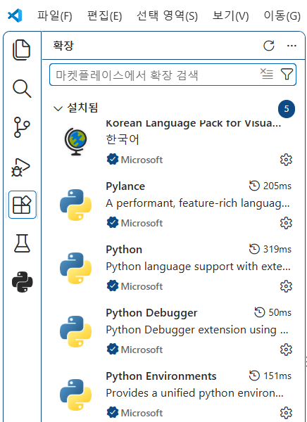

# VS Code 설치와 확장(Extensions)

> **한눈에 보기**
> - VS Code를 설치하고 파이썬 개발에 필요한 확장 5개를 설치했다.
> - 확장은 왼쪽 막대의 **확장(Extensions)** 아이콘(`Ctrl+Shift+X`)에서 검색해 설치한다.

## 설치한 확장

아래 이미지와 같은 extensions를 설치했다.

| 확장 | 하는 일 |
|---|---|
| Korean Language Pack | VS Code 메뉴를 한국어로 |
| Python | 파이썬 실행, 인터프리터(가상환경) 선택 |
| Pylance | 자동 완성, 타입 검사, 오류 표시 |
| Python Debugger | 중단점을 걸고 한 줄씩 실행하며 디버깅 |
| Python Environments | 가상환경 만들기·선택을 화면에서 관리 |

## 자주 쓰는 단축키

| 단축키 | 기능 |
|---|---|
| ``Ctrl + ` `` | 터미널 열기·닫기 |
| `Ctrl + Shift + P` | 명령 팔레트 (인터프리터 선택 등 모든 명령 검색) |
| `Ctrl + Shift + X` | 확장 열기 |
| `Shift + Enter` | 노트북에서 셀 실행 후 다음 셀로 |

## 복습 질문

1. 노트북이나 파이썬 파일을 실행했는데 설치한 라이브러리가 없다고 나오면?

VS Code가 다른 파이썬(인터프리터)을 쓰고 있을 가능성이 크다. `Ctrl+Shift+P` → "Python: Select Interpreter"(노트북은 오른쪽 위 커널 선택)에서 라이브러리를 설치한 가상환경을 고른다.

