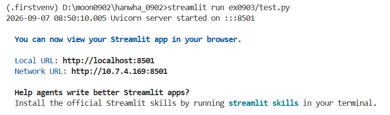

# Streamlit 시작하기

> **한눈에 보기**
> - Streamlit은 **파이썬 코드만으로 웹 화면**을 만드는 라이브러리다. HTML, CSS를 몰라도 버튼, 표, 차트를 띄울 수 있다.
> - 설치 `pip install streamlit` → 실행 `streamlit run 파일.py` → 브라우저에서 `http://localhost:8501`
> - 버튼을 누르는 등 무언가 바뀔 때마다 **스크립트 전체가 위에서부터 다시 실행**된다.

## 설치와 실행

```cmd
pip install streamlit
streamlit run ex0903/test.py
```



크롬에 자동으로 페이지가 열리지만, 직접 열고 싶으면 Local URL(`http://localhost:8501`)이나 Network URL을 주소창에 붙여 넣으면 된다. Network URL은 같은 네트워크의 다른 기기(휴대폰 등)에서 접속할 때 쓴다. 끌 때는 터미널에서 `Ctrl + C`.

## 코드 수정하고 확인하기

수정한 파일을 꼭 **저장**하고 Streamlit 페이지를 새로고침한다. (화면 오른쪽 위의 "Rerun", "Always rerun"을 누르면 저장할 때마다 자동으로 다시 실행된다.)

## 실습 코드 ([`test.py`](test.py))

```python
left, middle, right = st.columns(3)        # 화면을 3칸으로 나눈다
if left.button("Plain button", width="stretch"):   # 누른 순간에만 True
    left.markdown("You clicked the plain button.")
```

- `st.columns(3)`은 칸 3개를 돌려주고, 각 칸에 `.button()`, `.markdown()`처럼 요소를 넣는다.
- `button()`은 **누른 그 실행에서만 `True`**다. 버튼을 누르면 스크립트가 다시 실행되면서 `if` 안의 글이 보이고, 다른 버튼을 누르면 다시 실행되어 앞의 글은 사라진다.
- `icon=`에는 이모지(`"😊"`)나 Material 아이콘(`":material/mood:"`)을 넣는다.

## 복습 질문

<details>
<summary>1. Streamlit 앱을 실행하는 명령은?</summary>

<code>streamlit run 파일이름.py</code> (<code>python 파일이름.py</code>가 아님)
</details>

<details>
<summary>2. 버튼을 눌렀다 다른 버튼을 누르면 앞 버튼의 결과 글이 사라지는 이유는?</summary>

Streamlit은 상호작용이 있을 때마다 스크립트 전체를 다시 실행하고, <code>button()</code>은 누른 그 실행에서만 <code>True</code>이기 때문이다. 값을 계속 유지하려면 <code>st.session_state</code>에 저장한다.
</details>
