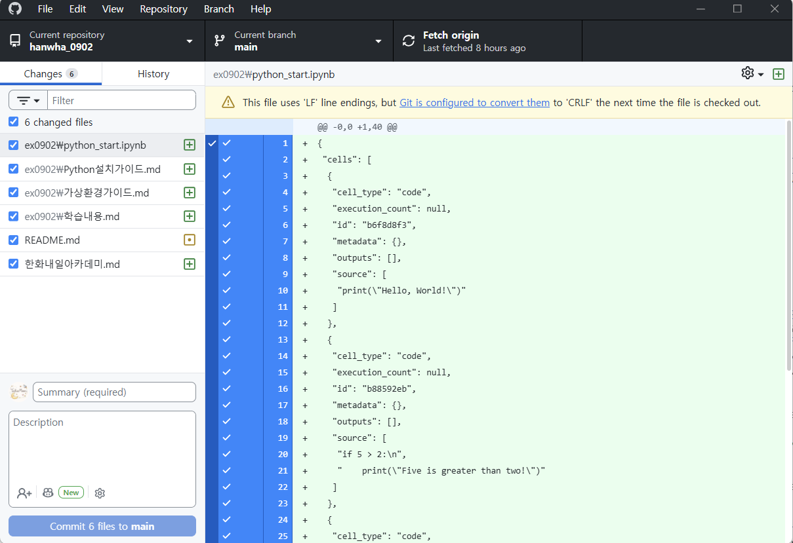

# GitHub Desktop 사용법

> **한눈에 보기**
> - 파일 수정 → **Commit**(변경 내용을 내 컴퓨터에 기록) → **Push**(깃허브 서버에 올리기)
> - 다른 곳에서 바뀐 내용은 **Fetch**(확인) → **Pull**(가져오기)로 받는다.
> - 작업 시작 전에 Pull부터 하면 충돌을 줄일 수 있다.

## 기본 흐름

1. 레포지토리의 파일을 수정하면 GitHub Desktop 왼쪽 **Changes** 목록에 바뀐 파일이 나타난다.
2. 깃허브에 반영하고 싶은 변경 내용을 체크하고, 아래에 제목(Summary)과 설명을 적어 **Commit**한다.
3. **Push origin** 버튼을 누르면 깃허브 서버에 반영된다.

| 용어 | 뜻 |
|---|---|
| Commit | 변경 내용을 하나의 기록(버전)으로 내 컴퓨터 저장소에 저장 |
| Push | 내 커밋들을 원격 저장소(깃허브)에 올림 |
| Fetch | 원격 저장소에 새 커밋이 있는지 확인만 함 (내 파일은 안 바뀜) |
| Pull | 원격 저장소의 새 커밋을 가져와 내 파일에 반영 |

## 주의사항

- 서로 다른 컴퓨터에서 같은 파일의 같은 부분을 수정하면, 나중에 Push하는 쪽에서 **충돌(conflict)**이 날 수 있다. 작업 전에 항상 Pull을 먼저 하는 것을 추천한다. 충돌이 났을 때 해결하는 방법은 [깃 충돌 해결법](../ex0907/깃충돌해결법.md)에 정리했다.
- 커밋하지 않은 변경 사항은 Discard(버리기)하면 되돌릴 수 없다. 버튼을 누르기 전에 무엇이 사라지는지 확인한다.

## 복습 질문

1. Commit과 Push의 차이는?

Commit은 변경 내용을 내 컴퓨터의 저장소에 기록하는 것이고, Push는 그 커밋들을 깃허브(원격 저장소)에 올리는 것이다. Commit만 하면 깃허브에는 아직 반영되지 않는다.

2. Fetch와 Pull의 차이는?

Fetch는 원격에 새 변경이 있는지 확인만 하고, Pull은 가져와서 내 파일에 합친다.

