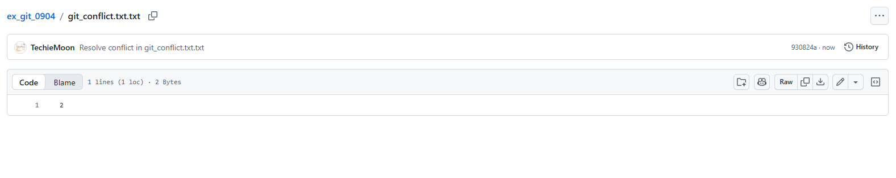
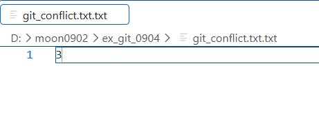
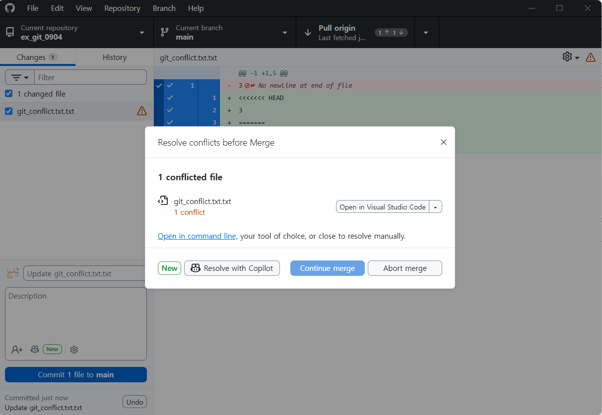

# 깃허브 충돌(conflict) 해결 방법

> **한눈에 보기**
> - 충돌은 **같은 파일의 같은 줄을 두 곳에서 서로 다르게 고친 뒤** 합칠 때 생긴다.
> - 최신 내용을 pull하지 않고 옛 커밋 위에서 고치고 push하면, push가 거절되고 pull할 때 충돌이 난다.
> - 충돌 난 파일에는 `<<<<<<<`, `=======`, `>>>>>>>` 표시가 생긴다. 남길 내용으로 고치고 표시를 지운 뒤 커밋·push한다.
> - 예방법: **작업 시작 전에 항상 pull(Fetch origin → Pull origin)** 부터.

## 1. 같은 파일을 하나의 컴퓨터에서 수정 후 push



## 2. 같은 파일을 다른 컴퓨터에서 수정 후 push



## 3. 에러 발생



에러가 발생한 이유는 이미 다른 컴퓨터에서 수정한 파일을 pull해서 이어서 수정하지 않고, **예전 commit 버전에서 수정했기 때문**이다.
깃은 두 수정 중 어느 쪽이 맞는지 알 수 없으므로 사람에게 고르라고 한다.

## 4. 에러 해결

```markdown
<<<<<<< HEAD
3
=======
2
>>>>>>> 930824ae26801605cd5864a36519d5f230f5affd
```

충돌이 나면 위와 같이 충돌이 일어난 문장들이 텍스트로 표시된다.

| 표시 | 뜻 |
|---|---|
| `<<<<<<< HEAD` ~ `=======` | 지금 내 컴퓨터(현재 브랜치)의 내용 |
| `=======` ~ `>>>>>>> 커밋번호` | 합치려고 가져온 쪽(다른 컴퓨터에서 올린 커밋)의 내용 |

해결 순서

1. 파일을 열어 남길 내용으로 직접 고친다 (한쪽만 남기거나, 둘을 합치거나).
2. `<<<<<<<`, `=======`, `>>>>>>>` 줄을 모두 지운다.
3. 저장 → 커밋 → 다시 push한다.

## 🔁 복습 질문

<details>
<summary>1. 충돌은 언제 생기나?</summary>

같은 파일의 같은 부분을 두 곳(다른 컴퓨터, 다른 브랜치)에서 다르게 고친 뒤 합치려 할 때 생긴다.
</details>

<details>
<summary>2. 충돌 표시에서 <code>HEAD</code> 쪽과 아래쪽은 각각 무엇인가?</summary>

`<<<<<<< HEAD`부터 `=======`까지가 내 쪽(현재 브랜치), `=======`부터 `>>>>>>>`까지가 가져온 커밋 쪽 내용이다.
</details>

<details>
<summary>3. 충돌을 해결한 뒤 꼭 해야 할 일은?</summary>

충돌 표시 줄 세 종류를 모두 지우고, 저장한 다음 커밋하고 push한다. 표시가 남아 있으면 코드가 깨진다.
</details>

<details>
<summary>4. 충돌을 줄이는 가장 쉬운 습관은?</summary>

다른 컴퓨터에서 작업을 시작하기 전에 먼저 pull해서 최신 상태에서 고친다.
</details>
