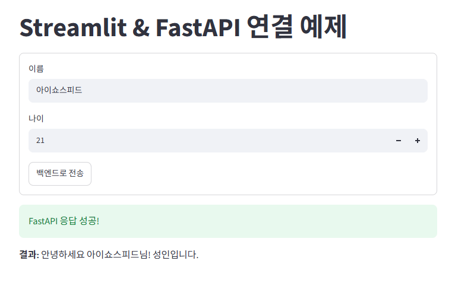

# streamlit으로 프론트엔드, fastapi로 백엔드 연결하기

> **한눈에 보기**
> - 화면(프론트엔드)은 **Streamlit**, 처리(백엔드)는 **FastAPI**로 나누고, 둘을 **HTTP 요청(JSON)** 으로 연결한다.
> - Streamlit: `st.form`으로 입력을 모아 `requests.post(URL, json=payload)`로 보내고, 응답 JSON을 화면에 보여 준다.
> - FastAPI: `/predict`가 Pydantic 모델(`UserInput`)로 받은 값을 처리해 결과를 JSON으로 돌려준다. 나중에 AI 모델이 들어갈 자리.
> - **서버를 두 개 띄워야 한다**: FastAPI(8000번 포트)와 Streamlit(8501번 포트). 백엔드가 꺼져 있으면 `ConnectionError`를 잡아 안내 메시지를 띄운다.
> - 코드: [proj_streamlit/app.py](proj_streamlit/app.py), [proj_fastapi/main.py](proj_fastapi/main.py)

## 실행 순서

```cmd
:: 터미널 1 - 백엔드
cd ex0910\proj_fastapi
uvicorn main:app --reload

:: 터미널 2 - 프론트엔드
cd ex0910\proj_streamlit
streamlit run app.py
```

브라우저에서 Streamlit 화면(`http://localhost:8501`)을 열고 버튼을 누르면, Streamlit이 FastAPI(`http://127.0.0.1:8000/predict`)에 요청을 보낸다.

```
[브라우저] → [Streamlit app.py] --POST /predict (JSON)--> [FastAPI main.py]
                                <-- {"result_message": ...} --
```

1. Streamlit

```python
import requests 
import streamlit as st 

FASTAPI_URL = "http://127.0.0.1:8000"

st.title("Streamlit & FastAPI 연결 예제")

# 입력 폼 구성 
with st.form("user_form"):
    name = st.text_input("이름", value="홍길동")
    age = st.number_input("나이", min_value=1, max_value=120, value=20)
    submit_button = st.form_submit_button("백엔드로 전송")

if submit_button:
    # FastAPI로 보낼 데이터 페이로드 
    payload = {
        "name": name,
        "age": age
    }

    try:
        # FastAPI /predict 엔드포인트에 POST 요청
        response = requests.post(f"{FASTAPI_URL}/predict", json=payload)

        if response.status_code == 200:
            result = response.json()
            st.success("FastAPI 응답 성공!")
            st.write(f"**결과:** {result['result_message']}")
        else:
            st.error(f"오류 발생 (상태 코드: {response.status_code})")

    except requests.exceptions.ConnectionError:
        st.error("FastAPI 서버에 연결할 수 없습니다. 백엔드 서버가 실행 중인지 확인해 주세요.")
```

2.FastAPI

```python
from fastapi import FastAPI 
from pydantic import BaseModel

app = FastAPI()

class UserInput(BaseModel):
    name: str 
    age: int 

@app.get("/")
def read_root():
    return {"message": "FastAPI 서버가 정상 동작 중입니다."}

@app.post("/predict")
def process_data(data: UserInput):
    # 비즈니스 로직 및 AI 모델 추론 처리 위치 
    is_adult = data.age >= 19
    message = f"안녕하세요 {data.name}님! " + ("성인입니다." if is_adult else "미성년자입니다.")

    return {
        "status": "success",
        "result_message": message,
        "is_adult": is_adult 
    }
```

3. 결과



## 4. 같은 날 배운 파이썬 제어문

| 노트북 | 내용 |
|---|---|
| [dictionary.ipynb](dictionary.ipynb) | 중첩 딕셔너리 만들기·접근·수정 |
| [if_else.ipynb](if_else.ipynb) | `if`/`elif`/`else`, 한 줄 if, 조건 표현식 |
| [match_case.ipynb](match_case.ipynb) | `match`/`case`, `case _`(그 외), `case 1 \| 2` |
| [while.ipynb](while.ipynb) | `while`, `break`, `continue`, `while … else` |
| [for.ipynb](for.ipynb) | `for`, `range()`, `break`/`continue`, `for … else`, 중첩 반복 |

## 🔁 복습 질문

<details>
<summary>1. 이 예제에서 Streamlit과 FastAPI는 각각 무슨 역할인가?</summary>

Streamlit은 입력을 받고 결과를 보여 주는 화면(프론트엔드), FastAPI는 받은 데이터를 처리해 결과를 돌려주는 서버(백엔드)다.
</details>

<details>
<summary>2. Streamlit에서 FastAPI로 데이터를 보내는 코드는?</summary>

`requests.post(f"{FASTAPI_URL}/predict", json=payload)`. `json=`으로 dict를 넘기면 JSON 본문으로 바뀌어 전송된다. 응답은 `response.json()`으로 dict로 받는다.
</details>

<details>
<summary>3. FastAPI 서버를 켜지 않고 버튼을 누르면?</summary>

`requests.exceptions.ConnectionError`가 나고, `except`에서 잡아 "FastAPI 서버에 연결할 수 없습니다…" 오류 메시지를 화면에 띄운다.
</details>

<details>
<summary>4. <code>st.form</code>을 쓰는 이유는?</summary>

Streamlit은 입력값이 바뀔 때마다 스크립트를 다시 실행한다. 폼으로 묶으면 제출 버튼을 누를 때 한 번에 처리된다.
</details>

<details>
<summary>5. <code>for x in range(6): ... else: ...</code>에서 else는 언제 실행되나?</summary>

반복이 `break` 없이 끝까지 돌았을 때만 실행된다. 중간에 `break`로 빠져나가면 실행되지 않는다. `while … else`도 같다.
</details>

<details>
<summary>6. <code>match</code>에서 <code>case _:</code>는 무슨 뜻인가?</summary>

앞의 어떤 case에도 맞지 않을 때 실행되는 "그 외" 경우다. if문의 `else`와 비슷하다.
</details>

