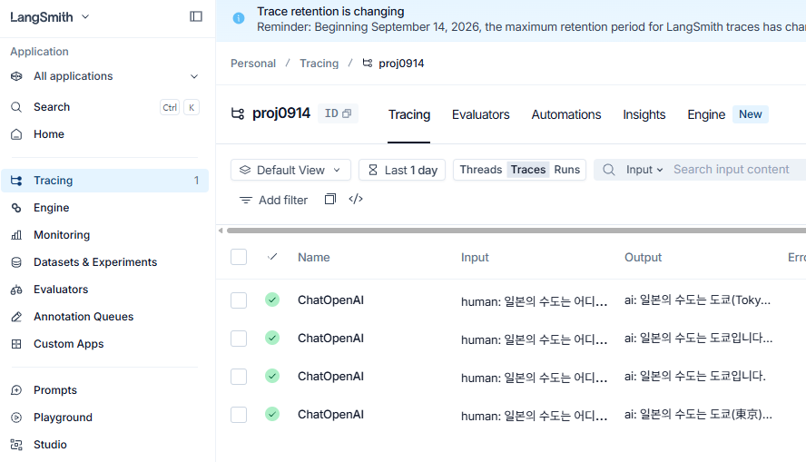

# 랭체인 사용법

> **한눈에 보기**
> - LangChain의 `ChatOpenAI`로 OpenAI 모델을 호출한다: `llm.invoke(질문)` → `AIMessage`, 답 글자는 `.content`
> - **LangSmith**: 코드는 그대로 두고 환경변수(또는 `langchain_teddynote.logging`)만 설정하면 모든 호출 기록이 사이트에 남는다
> - **에이전트**: `@tool`로 함수를 도구로 만들고 `create_agent(model, tools)`로 묶으면, 모델이 필요할 때 도구를 스스로 호출한다
> - 도구 설명은 함수의 **docstring**이 그대로 쓰이므로 꼭 적는다

| 노트북 | 내용 |
|---|---|
| [ch03.ipynb](ch03.ipynb) | 가상환경 확인, `.env`로 API 키 불러오기 |
| [ch04.ipynb](ch04.ipynb) | `ChatOpenAI` 호출, 토큰 사용량, logprobs, stream |
| [ch04_langsmith.ipynb](ch04_langsmith.ipynb) | LangSmith 추적, `@tool` + `create_agent` |

## 0. 준비: `.env`로 키 불러오기 ([ch03.ipynb](ch03.ipynb))

```python
from dotenv import load_dotenv
load_dotenv()   # .env의 OPENAI_API_KEY 등을 환경변수로 등록, 성공하면 True

import os
print(os.environ["OPENAI_API_KEY"][:8])   # 앞 8글자(sk-proj-)만 찍어 확인. 키 전체는 절대 출력하지 않는다
```

LangSmith를 쓰려면 `.env`에 `LANGSMITH_API_KEY`, `LANGSMITH_PROJECT` 등도 넣는다. `.env`는 `.gitignore`에 넣어 깃허브에 올리지 않는다.

다음과 같이 임포트 해야함

```python
from langchain_openai import ChatOpenAI
```

그 전에 패키지 설치해야 함

```cmd
pip install langchain_openai
```

다음과 같이 코드를 작성하면 ChatGPT의 답변을 얻을 수 있다.

```python 
llm = ChatOpenAI(
    temperature=0.1,
    model="gpt-4o-mini"
)

question = "미국의 수도는 어딜까요?"

response = llm.invoke(question)

print(response.content)
```

출력:

```txt
미국의 수도는 워싱턴 D.C.입니다.
```

# 랭스미스 사용법

```python
from langchain_openai import ChatOpenAI 

llm = ChatOpenAI(model="gpt-4o-mini")
question = "일본의 수도는 어디인가요?"
response = llm.invoke(question)
print(response.content)
```

출력:

```txt
일본의 수도는 도쿄(Tokyo)입니다. 도쿄는 일본의 정치, 경제, 문화의 중심지로 알려져 있습니다.
```

랭체인이랑 코드는 같지만 다음과 같은 이미지처럼 langsmith 사이트에 기록이 저장된다.




# 에이전트(Agent)와 Tool 사용법

다음과 같이 임포트 해야함

```python
from langchain_core.tools import tool
from langchain.agents import create_agent
```

`@tool` 데코레이터를 붙이면 함수를 에이전트가 쓸 수 있는 Tool로 만들 수 있다. 이때 함수의 docstring이 그대로 Tool 설명으로 쓰이기 때문에 꼭 작성해야 한다.

```python
# 1. Tool 정의
@tool
def get_weather(city: str) -> str:
    """Get weather for a given city."""
    return f"It's always sunny in {city}!"

llm = ChatOpenAI(model="gpt-4o-mini", temperature=0)
agent = create_agent(model=llm, tools=[get_weather])

result = agent.invoke({"messages": [("user", "San Francisco 날씨 어때?")]})
print(result["messages"][-1].content)
```

출력:

```txt
샌프란시스코의 날씨는 항상 맑습니다!
```

`create_agent(model=llm, tools=[...])`로 모델과 사용할 Tool 목록을 넣어서 에이전트를 만든다. `agent.invoke({"messages": [("user", 질문)]})` 형태로 질문을 보내면, 에이전트가 스스로 판단해서 필요할 때 정의해둔 Tool(get_weather)을 호출한 뒤 답을 만든다. 결과는 메시지 리스트로 오기 때문에 `result["messages"][-1].content`로 마지막 메시지 내용만 꺼내서 확인하면 된다.

# langchain_teddynote로 랭스미스 추적 켜고 끄기

`.env`에 LangSmith 관련 환경변수를 넣어두는 방식 말고, `langchain_teddynote` 패키지를 쓰면 코드 한 줄로 추적을 켜고 끌 수 있다.

```cmd
pip install langchain_teddynote
```

```python
from langchain_teddynote import logging

# 랭스미스 추적 시작
logging.langsmith("proj0914", set_enable=True)
```

출력:

```txt
LangSmith 추적을 시작합니다.
[프로젝트명]
proj0914
```

추적을 끄고 싶으면 `set_enable=False`로 호출하면 된다.

```python
logging.langsmith("proj0914", set_enable=False)
```

## 🔁 복습 질문

<details>
<summary>1. <code>llm.invoke("미국의 수도는?")</code>의 결과에서 답 글자만 꺼내려면?</summary>

`response.content`. 결과는 `AIMessage` 객체이고, 토큰 사용량은 `response.response_metadata["token_usage"]`에 있다.
</details>

<details>
<summary>2. LangSmith를 켜면 코드에서 무엇이 바뀌나?</summary>

호출 코드는 그대로다. 환경변수(또는 `logging.langsmith("프로젝트명")`)만 설정하면 호출의 입력·출력·시간·토큰이 LangSmith 사이트에 기록된다.
</details>

<details>
<summary>3. <code>@tool</code>로 만든 함수에 docstring을 꼭 써야 하는 이유는?</summary>

docstring이 도구 설명으로 모델에게 전달된다. 모델은 이 설명을 보고 언제 이 도구를 쓸지 판단한다.
</details>

<details>
<summary>4. 에이전트 결과 <code>result["messages"]</code>의 마지막 메시지만 보는 이유는?</summary>

결과에는 사용자 질문 → 도구 호출 요청 → 도구 결과 → 최종 답이 순서대로 쌓여 있다. 최종 답은 맨 마지막(`[-1]`) 메시지다.
</details>

<details>
<summary>5. 키를 확인할 때 <code>[:8]</code>처럼 앞부분만 출력하는 이유는?</summary>

노트북 출력도 깃허브에 올라가기 때문이다. 키 전체가 출력에 남으면 코드에서 지워도 노출된다.
</details>
