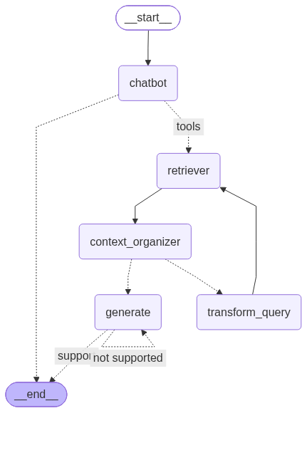

# 랭그래프로 RAG 에이전트 만들기

앞에서 PDF(한글 맞춤법·표준어 규정 해설)를 Chroma 벡터 DB에 저장하고([벡터DB저장과검색.md](벡터DB저장과검색.md)), 검색기와 검색 도구를 만들었다([검색도구만들기.md](검색도구만들기.md)). 이번에는 그 검색기를 랭그래프 그래프에 넣어 **문서를 근거로 답하는 RAG 에이전트**를 완성했다(교재 6.5.4 ~ 6.5.5). 단순히 "검색 → 답변"으로 끝나지 않고, 검색 결과로 질문에 답할 수 있는지, 답변이 검색 결과에 근거하는지를 LLM이 **스스로 평가**해서 질문을 다시 쓰거나 답변을 다시 만드는 구조다.

- 코드: [`rag_agent/`](rag_agent/) (`state.py`, `nodes.py`, `edges.py`, `agent.py`, `langgraph.json`, 검색기는 [`retriever.py`](rag_agent/retriever.py))
- 실행: `ex1008` 폴더에서 `uv run rag_agent/agent.py` (랭그래프 서버는 `rag_agent` 폴더에서 `langgraph dev`)

## 1. 그래프 구조



`agent.py`를 실행하면 `draw_mermaid_png()`로 그린 위 그림이 `graph.png`로 저장된다. 실선은 항상 가는 엣지, 점선은 조건부 엣지다.

| 파일 | 내용 |
|---|---|
| `state.py` | 그래프 상태 `AgentState` |
| `nodes.py` | 노드 5개: `chatbot`, `retrieve`, `context_organizer`, `transform_query`, `generate` |
| `edges.py` | 조건부 엣지 함수 2개: `decide_to_generate`(검색 결과 평가), `check_hallucinations`(환각 평가) |
| `agent.py` | 노드와 엣지를 연결해 그래프를 만들고 실행 |
| `langgraph.json` | 랭그래프 서버(`langgraph dev`)용 설정 |

## 2. 상태

```python
class AgentState(MessagesState):
    question: str    # 검색에 쓸 질문 (다시 쓰면 바뀜)
    context: str     # 검색 결과 (쪽 번호 포함)
    answer: str      # 생성한 답변
    retry_num: int   # 질문을 다시 쓴 횟수
    generate_num: int  # 답변을 만든 횟수 (무한 반복 방지용으로 추가)
```

`MessagesState`를 상속해서 대화 기록(`messages`)은 그대로 누적하고, RAG 흐름에 필요한 값을 더했다. 그래프는 `StateGraph(AgentState, input_schema=MessagesState)`로 만들어서, 사용자는 `{"messages": [...]}`만 넣으면 되고 나머지는 노드들이 채운다.

## 3. 노드

| 노드 | 하는 일 | 상태 변화 |
|---|---|---|
| `chatbot` | 검색 도구를 `bind_tools`한 LLM이 검색이 필요한지 판단 | `messages`에 응답, `question`에 사용자 질문, `retry_num`·`generate_num`을 0으로 초기화 |
| `retriever` (`retrieve`) | `question`으로 청크 5개를 검색하고 `Page N: 내용` 형식으로 이어 붙임 (처음엔 3개, 8절 참고) | `context`, `messages`에 `ToolMessage` |
| `context_organizer` | PDF 특유의 들쭉날쭉한 공백과 빈 줄을 코드로 정리하고 쪽마다 빈 줄로 구분 (처음엔 LLM이 정리, 8절 참고) | `context`를 정리본으로 교체 |
| `transform_query` | 벡터 검색이 잘 되도록 질문을 다시 씀 | `question` 교체, `retry_num` + 1 |
| `generate` | 검색 결과를 근거로 답하고 출처(쪽 번호)를 붙임. `retry_num`이 3 이상이면 답하지 못한다고 알리고 검색 결과로 답할 수 있는 다른 질문을 제안 | `answer`, `generate_num` + 1 |

`retrieve`는 `chatbot`의 도구 호출(`tool_calls`)에 대한 답으로 `ToolMessage`를 만든다. `tool_calls`가 있는 AIMessage 다음에는 같은 `tool_call_id`를 가진 `ToolMessage`가 와야 대화 기록 형식이 맞기 때문이다. 다만 실제 검색은 도구를 실행하는 게 아니라 노드가 `retriever.invoke()`를 직접 부르는 방식이다.

## 4. 조건부 엣지

```python
graph_builder.add_conditional_edges("chatbot", tools_condition, {"tools": "retriever", END: END})
graph_builder.add_conditional_edges("context_organizer", decide_to_generate,
                                    {"transform_query": "transform_query", "generate": "generate"})
graph_builder.add_edge("transform_query", "retriever")
graph_builder.add_conditional_edges("generate", check_hallucinations,
                                    {"not supported": "generate", "support": END})
```

| 분기 | 판단 방법 | 결과 |
|---|---|---|
| `tools_condition` | 마지막 메시지에 `tool_calls`가 있는지 (랭그래프 제공 함수) | 있으면 검색, 없으면 `chatbot`의 답변으로 종료 |
| `decide_to_generate` | LLM이 `with_structured_output(Grade)`로 검색 결과에 질문의 답(정의, 조건 등 핵심 내용)이 있는지를 `yes`/`no`로 평가 (처음엔 관련성만 평가, 8절 참고) | `no`면 질문 다시 쓰기, `yes`면 답변. `retry_num`이 3 이상이면 평가 없이 답변 |
| `check_hallucinations` | LLM이 `with_structured_output(GradeHallucinations)`로 답변이 검색 결과에 근거하는지 평가 | `yes`면 종료, `no`면 답변 다시 생성. 답변을 3번 만들었으면 평가 없이 종료 |

평가는 `with_structured_output`에 pydantic 모델을 넘겨서, LLM의 답을 자유 문장이 아니라 `binary_score` 필드 하나로 받는다. 그래서 `if grade == "no"`처럼 코드로 바로 분기할 수 있다.

## 5. 분기별 흐름 확인

API를 호출하지 않고 흐름만 보려고, LLM과 검색기를 정해진 답을 돌려주는 가짜 객체로 바꿔서 평가 결과별로 어떤 노드를 거치는지 확인했다. (노드와 엣지 코드는 그대로 사용)

| 상황 | 거친 노드 |
|---|---|
| 답 있음 + 근거 있음 | chatbot → retriever → context_organizer → generate → 종료 |
| 도구 호출 없음 (일반 대화) | chatbot → 종료 |
| 검색 결과 평가가 계속 `no` | chatbot → (retriever → context_organizer → transform_query) × 3 → retriever → context_organizer → generate → 종료. 검색 4번, 마지막 답변은 "답하지 못함 + 다른 질문 제안" 프롬프트 |
| 환각 평가가 계속 `no` | 고치기 전: chatbot → retriever → context_organizer → generate → generate → … → **`GraphRecursionError`** (25단계)<br>고친 뒤: chatbot → retriever → context_organizer → generate → generate → generate → 종료 |
| 같은 스레드에서 두 번째 질문 (`checkpointer` 사용) | 고치기 전: 첫 질문에서 `retry_num`이 3까지 올라가면 두 번째 질문은 관련성 평가 없이 바로 "답하지 못함" 답변으로 감<br>고친 뒤: `chatbot`이 횟수를 0으로 되돌려서 두 번째 질문도 처음부터 평가 |

## 6. 확인하고 고친 점

흐름을 확인하다가 문제 3가지를 찾아서 고쳤다. (고친 부분마다 코드에 이유를 주석으로 남겼다)

| 문제 | 원인 | 고친 방법 |
|---|---|---|
| 환각 평가가 계속 `no`면 `GraphRecursionError` | 재검색은 `retry_num`으로 3번에서 멈추지만, 답변 재생성(`generate` → `check_hallucinations` → `generate`)에는 횟수 제한이 없었다 | 상태에 `generate_num`을 추가하고 `generate`가 1씩 올린다. `check_hallucinations`는 3번째 답변이면 평가 없이 종료한다 |
| 재검색하면 출력 루프에서 `AttributeError` | 질문을 다시 쓴 뒤의 `retrieve`는 마지막 메시지에 `tool_calls`가 없어서 `{"messages": [context]}`처럼 **문자열**을 돌려줬다. `graph.stream()`은 노드가 돌려준 값을 그대로 내보내서 `value['messages'][0].content`에서 에러가 났고, 대화 기록에는 `add_messages`가 문자열을 `HumanMessage`로 바꿔 검색 결과가 사용자 메시지처럼 남았다 | `AIMessage(context)`로 감싸서 돌려준다 |
| 같은 스레드에서 다음 질문에 횟수가 이어짐 | `retry_num`을 늘리기만 하고 되돌리지 않았다. 체크포인터를 쓰는 랭그래프 스튜디오에서 같은 스레드로 질문을 이어 가면, 앞 질문에서 3이 된 값 때문에 다음 질문은 재검색 없이 바로 "답하지 못함" 답변으로 갔다 | `chatbot`이 새 질문을 받을 때 `retry_num`, `generate_num`을 0으로 되돌린다 |

세 가지 모두 가짜 LLM으로 고치기 전에는 문제가 재현되고, 고친 뒤에는 위 표처럼 정상 종료되는 것을 확인했다. "구개음화가 뭐야?"처럼 한 번에 평가를 통과하는 질문은 고치기 전에도 이 경로들을 지나지 않아서 문제가 드러나지 않았다.

그 밖에 확인한 점:

- **LLM이 만든 검색어는 쓰이지 않는다.** `chatbot`의 도구 호출에는 LLM이 정한 검색어(`args["query"]`)가 들어 있지만, `retrieve`는 `state["question"]`(사용자 질문 원문)으로 검색한다. 도구 호출은 "검색할지 말지"를 정하는 신호로만 쓰인다.
- **쪽 번호:** `retrieve`는 `doc.metadata['page'] + 1`로 쪽 번호를 붙인다. `PyPDFLoader`의 `page`는 0부터 시작하고, 이 PDF는 DB에 저장된 `page_label`과 `page + 1`이 같았다. 검색 도구(`create_retriever_tool`)는 쪽 번호를 빼고 돌려줬는데([검색도구만들기.md](검색도구만들기.md)), 노드에서 직접 검색하니 쪽 번호를 넣을 수 있어서 `generate`가 출처를 밝힐 수 있다.
- **LLM 호출 수:** 한 번에 통과해도 chatbot, 검색 결과 평가, 답변, 환각 평가로 `gpt-4o`를 4번 부른다(정리 단계를 LLM으로 하던 처음 코드는 5번). 품질을 높이는 대신 시간과 비용이 늘어난다.
- **`langgraph dev`로 실행할 때 경로 (고침):** `rag_agent/langgraph.json`이 `"env": ".env"`였는데 `.env`는 `rag_agent`가 아니라 `ex1008` 폴더에 있어서 `"../.env"`로 바꿨다. 또 검색기의 DB 경로가 실행 위치 기준(`./rag_agent/chroma_db`)이라 `rag_agent` 폴더에서 서버를 띄우면 빈 DB를 검색하게 돼서, `retriever.py`의 경로를 파일 위치 기준(`Path(__file__).parent / "chroma_db"`)으로 바꿨다. 이제 어느 폴더에서 실행하든 `rag_agent/chroma_db`를 찾는다.
- 처음 만든 파일 이름이 `edgds.py`(오타)여서 `edges.py`로 바꿨다. `agent.py`가 `from edges import ...`로 불러온다.

## 7. 실제 실행 결과 (검색·정리 단계를 고치기 전)

6절의 문제를 고친 뒤 실제 API로 "구개음화가 뭐야?"를 실행했다. (출력이 길어서 검색 결과 본문은 줄였다)

```txt
PS ...\rag_agent> uv run agent.py
----- [CHATBOT] -----
--- chatbot ---

============================================================
----- [RETRIEVER] -----
--- retriever ---
Page 24: 는 부사 파생 접미사가 결합하여 부사가 되었으므로 구개음화가 실현되었지만, ‘곧이
어’는 형식 형태소가 아닌 실질 형태소 부사가 결합한 말이므로 구개음화가 실현되지 ...
Page 240: ‘한글 맞춤법’, ‘표준어 규정’ 해설
결합할 때에도 연음이 되지 않는다. 연음이 되려면 ‘ㄷ, ㅌ’이 그대로 초성으로 발음되
어야 하는데, 구개음화(표준 발음법 제17항 참조)가 적용되어 ‘ㅈ, ㅊ’으로 바뀌기 때 ...
Page 252: ‘한글 맞춤법’, ‘표준어 규정’ 해설
경음화제6장
제23항
받침 ‘ㄱ(ㄲ, ㅋ, ㄳ, ㄺ), ㄷ(ㅅ, ㅆ, ㅈ, ㅊ, ㅌ), ㅂ(ㅍ, ㄼ, ㄿ, ㅄ)’ 뒤에 연결되는 ...
============================================================
----- [CONTEXT ORGANIZER] -----
----- ASSESS GRADED DOCUMENTS -----
---DECISION: GENERATE---
--- context_organizer ---
Page 24: 부사 파생 접미사가 결합하여 부사가 되었으므로 구개음화가 실현되었지만, ... 
Page 240: ‘한글 맞춤법’, ‘표준어 규정’ 해설
구개음화는 형태소 결합 시 ‘ㄷ, ㅌ’이 초성으로 발음되지 않고 구개음화(표준 발음법 제17항 참조)에 의해
‘ㅈ, ㅊ’로 바뀌기 때문이다. ... 부엌이[부어키], 부엌을[부어클], 꽃이[꼬치], 꽃을[꼬츨]과 같은 발음이 옳다. ...
Page 252: ‘한글 맞춤법’, ‘표준어 규정’ 해설
경음화 제6장 제23항: ... 예시로 국밥[국빱], 깎다[깍따], 넋받이[넉빠지], 삯돈[삭똔], 닭장[닥짱], 칡범[칙뻠], 등에서 ...
============================================================
----- [GENERATE] -----
----- CHECK HALLUCINATIONS -----
---DECISION: GENERATION IS GROUNDED IN DOCUMENTS---
--- generate ---
구개음화는 형태소 결합 시 발음에서 변화가 일어나는 현상으로, 'ㄷ'이나 'ㅌ'이 초성 위치에서 'ㅈ'이나 'ㅊ'으로
바뀌는 것을 말합니다. 예를 들어, "곧이"는 구개음화가 적용되어 [고지]로 발음되는 반면, "곧이어"는 실질 형태소
부사가 결합한 말이라서 구개음화가 일어나지 않습니다 (Page 24). '한글 맞춤법'의 규정에 따르면, 이는 형태소가
결합할때 발생하는 발음 변화입니다 (Page 240).
============================================================
```

흐름은 chatbot → retriever → context_organizer → generate → 종료로, 관련성 평가와 환각 평가를 한 번에 통과했다. LLM은 5번 호출됐다(chatbot, 정리, 관련성 평가, 답변, 환각 평가).

이번에는 `rag_agent` 폴더 안에서 실행했는데도 검색 결과가 정상으로 나왔다. 고치기 전 경로(`./rag_agent/chroma_db`)였다면 이 위치에서는 빈 DB를 검색했을 것이다. (`graph.png`도 실행한 위치인 `rag_agent` 폴더에 새로 생겼다. 내용은 `ex1008/graph.png`와 같다)

결과를 보고 확인한 점:

| 쪽 | 검색된 내용 | 질문과의 관련성 |
|---|---|---|
| 24쪽 | `곧이[고지]`와 `곧이어[고디어]` 비교. 구개음화는 형태소와 형태소가 결합할 때 일어난다 | 관련 있음 |
| 240쪽 | 연음 규칙을 설명하다가 예외로 구개음화를 언급 | 일부 관련 |
| 252쪽 | 경음화(표준 발음법 제23항) | 관련 없음 |

- **정작 정의 조항은 검색되지 않았다.** 구개음화를 정의한 표준 발음법 제17항("받침 'ㄷ, ㅌ(ㄾ)'이 조사나 접미사의 모음 'ㅣ'와 결합되는 경우에는 [ㅈ, ㅊ]으로 바꾸어서 뒤 음절 첫소리로 옮겨 발음한다")은 벡터 DB의 245쪽 청크에 있는데 상위 3개에 들지 못했다. 그래서 답변에 **모음 'ㅣ'와 결합할 때**라는 핵심 조건이 빠졌다. 관련성 평가는 "관련 있음"이었으므로 재검색도 일어나지 않았다. 관련성 평가는 "조금이라도 관련 있는가"만 보고, "답하기에 충분한가"는 보지 않는다.
- **`context_organizer`가 정리가 아니라 내용을 고쳐 썼다.** 프롬프트에는 "내용을 삭제하는 것을 최소로" 하라고 했지만, 240쪽 정리본은 원문에 없는 문장("구개음화는 형태소 결합 시 …")으로 시작하고, 잘못된 발음 예(`부엌이[부어기]` ×)는 빠지고 맞는 발음만 남았다. 252쪽은 예시 목록이 중간에서 잘렸다.
- **그 결과 출처가 틀렸다.** 최종 답변은 "형태소가 결합할 때 발생하는 발음 변화"의 출처를 240쪽이라고 했는데, 이 내용은 원래 24쪽에 있고 240쪽 원문에는 없다. 정리 단계에서 240쪽에 끼어든 문장을 근거로 삼은 것이다.
- **환각 평가는 이걸 잡지 못한다.** `check_hallucinations`는 답변을 **정리된 context**와 비교한다. 정리본에는 그 문장이 240쪽에 있으므로 "근거 있음"으로 통과했다. 정리 단계에서 생긴 왜곡은 뒤의 평가로 걸러지지 않는다.

그래서 아래처럼 고쳤다(8절).

## 8. 실행 결과를 보고 고친 점

| 문제 | 고친 방법 | 이유 |
|---|---|---|
| `context_organizer`(LLM)가 원문을 고쳐 써서 출처가 틀림 | LLM 대신 **코드로 공백만 정리**한다. 연속된 공백을 하나로 줄이고 빈 줄을 지운 뒤, 쪽(청크)마다 빈 줄로 구분한다 | 정리 단계에서 내용이 바뀔 여지가 없어지고, 답변 생성과 환각 평가가 원문을 기준으로 한다. LLM 호출도 5번에서 4번으로 줄어든다 |
| 정의 조항(245쪽)이 상위 3개에 들지 못함 | 에이전트가 쓰는 검색기를 `k=5`로 따로 만들었다 (`vectorstore.as_retriever(search_kwargs={"k": 5})`). 6.5.3의 `retriever.py`(k=3 검색기와 검색 도구)는 그대로 둠 | 후보를 더 넓게 가져온다 |
| 관련성 평가가 "관련 단어만 있어도 yes"라서 재검색이 안 일어남 | 평가 기준을 **"질문에 답하는 데 필요한 핵심 내용(정의, 적용 조건 등)이 있는가"**로 바꿨다 | 핵심이 빠졌으면 질문을 다시 써서 재검색한다. 재검색은 그대로 최대 3번 |

어떤 쪽을 고를지 판단한 기준: 원문을 쓰는 쪽은 효과가 확실하다(정리 단계가 내용을 바꾸는 문제 자체가 사라짐). 반면 `k`를 늘리는 것과 평가 기준을 바꾸는 것은 정의 조항이 실제로 검색되는지 다시 실행해 봐야 알 수 있었다.

코드로 정리한 결과가 원문과 같은지는 위 실행 결과의 24쪽·240쪽 원문 일부로 확인했다. 공백과 줄바꿈을 모두 빼고 비교하면 정리 전후 글자가 완전히 같았다.

### 고친 뒤 다시 실행한 결과

같은 질문("구개음화가 뭐야?")으로 다시 실행했다. (검색 결과 본문은 줄였다)

```txt
----- [RETRIEVER] -----
--- retriever ---
Page 24: 는 부사 파생 접미사가 결합하여 부사가 되었으므로 구개음화가 실현되었지만, ...
Page 240: ‘한글 맞춤법’, ‘표준어 규정’ 해설 ...
Page 252: ‘한글 맞춤법’, ‘표준어 규정’ 해설 경음화제6장 제23항 ...
Page 245: 이 현상은 주격 조사 ‘이’ 앞에서도 일어나고 접미사 ‘-이’ 앞에서도 일어난다.
[붙임]에서는 ‘ㄷ’으로 끝나는 말 뒤에 ‘이’가 아닌 ‘히’가 결합할 때에도 구개음화가 
일어난다고 규정했다. 이 경우 먼저 ‘ㄷ’과 ‘히’의 ‘ㅎ’이 [ㅌ]으로 축약되는데, 이는 ‘ㅌ’ 
뒤에 ‘ㅣ’가 결합하는 것과 비슷하기 때문에 구개음화가 적용되어 [ㅊ]이 된다.
Page 8: 제6장 경음화 ··················································· 250
제7장 음의 첨가 ·············································· 256
============================================================
----- [CONTEXT ORGANIZER] -----
----- ASSESS GRADED DOCUMENTS -----
---DECISION: GENERATE---
--- context_organizer ---
Page 24: 는 부사 파생 접미사가 결합하여 부사가 되었으므로 구개음화가 실현되었지만, ‘곧이
어’는 형식 형태소가 아닌 실질 형태소 부사가 결합한 말이므로 구개음화가 실현되지
않는다.
...                                (원문 그대로, 공백과 빈 줄만 정리)
============================================================
----- [GENERATE] -----
----- CHECK HALLUCINATIONS -----
---DECISION: GENERATION IS GROUNDED IN DOCUMENTS---
--- generate ---
구개음화는 한국어에서 형태소와 형태소가 결합할 때 'ㄷ'이나 'ㅌ'이 모음 'ㅣ' 앞에서 각각 'ㅈ'이나 'ㅊ'으로
변화하는 음운 현상입니다. 이는 형태소 결합 시에만 발생하며, 하나의 형태소 내부에서는 구개음화가 일어나지
않습니다 (페이지 24).
============================================================
```

고치기 전과 비교:

| | 고치기 전 | 고친 뒤 |
|---|---|---|
| 검색된 쪽 | 24, 240, 252 | 24, 240, 252, **245**, 8 |
| 정리 단계 | LLM이 문장을 고쳐 쓰고 예시를 뺌 (240쪽에 원문에 없는 문장) | 원문 그대로, 줄 끝 공백과 빈 줄만 정리 |
| 검색 결과 평가 | 통과 (재검색 없음) | 통과 (재검색 없음) |
| 답변 | "ㄷ, ㅌ이 ㅈ, ㅊ으로 바뀐다" (조건 없음) | "ㄷ, ㅌ이 **모음 'ㅣ' 앞에서** ㅈ, ㅊ으로 바뀐다", 형태소 내부에서는 일어나지 않음 |
| 출처 | 24쪽, 240쪽 (240쪽은 틀린 출처) | 24쪽 |
| LLM 호출 | 5번 | 4번 |

확인한 점:

- **핵심 조건이 답변에 들어갔다.** `k=5`로 늘리니 245쪽 청크가 4순위로 들어왔고, 이 청크의 "'ㅌ' 뒤에 'ㅣ'가 결합"이라는 내용 덕분에 답변에 "모음 'ㅣ' 앞에서"라는 조건이 생겼다.
- **다만 정의 조항 자체는 여전히 검색되지 않았다.** 이번에 들어온 245쪽 청크는 [붙임](‘히’가 결합하는 경우)을 설명하는 부분이고, 제17항 본문("받침 'ㄷ, ㅌ(ㄾ)'이 조사나 접미사의 모음 'ㅣ'와 결합되는 경우에는 …")은 같은 245쪽의 다른 청크라 5위 안에 없었다. 5순위는 목차(8쪽)여서 쓸모가 없었다.
- **평가 기준을 바꿨지만 재검색은 일어나지 않았다.** 평가 LLM은 이번 검색 결과로 답할 수 있다고 판단했다. 결과적으로 답변은 맞았지만, "충분한가"를 판단하는 것도 LLM이라 정의 조항이 빠진 것까지 잡아내지는 못했다.
- **출처 표시는 아직 정확하지 않다.** 답변 전체의 출처를 24쪽으로 달았지만, "모음 'ㅣ' 앞에서"는 24쪽이 아니라 245쪽 청크에서 온 내용이다. 원문을 쓰도록 고쳐서 없는 문장을 출처로 대는 문제는 사라졌지만, 문장마다 정확한 쪽을 붙이게 하려면 답변 프롬프트를 "문장마다 근거 쪽 번호를 붙여라"처럼 더 구체적으로 써야 한다.
- 정리 단계는 원문을 그대로 남겼다. 고치기 전 LLM 정리본은 24쪽 첫 글자 '는'도 지웠는데, 이번에는 원문 그대로다.

## 정리

| 개념 | 코드 | 핵심 |
|---|---|---|
| 상태 확장 | `class AgentState(MessagesState)` + `input_schema=MessagesState` | 입력은 messages만, 내부에서 question·context·answer·retry_num·generate_num 관리 |
| 검색 여부 판단 | `bind_tools([retriever_tool])` + `tools_condition` | 필요할 때만 검색, 아니면 바로 답변 |
| 검색 결과 정리 | 코드로 공백만 정리 | LLM에게 정리를 맡기면 내용이 바뀔 수 있다 |
| 검색 결과 평가 | `with_structured_output(Grade)` → `yes`/`no` | 답의 핵심이 없으면 질문을 다시 써서 재검색 (최대 3번) |
| 질문 다시 쓰기 | `transform_query` → `retriever` | 벡터 검색에 맞게 질문 변환 |
| 답변 평가 | `with_structured_output(GradeHallucinations)` | 근거 없으면 다시 생성 (최대 3번) |
| 출처 표시 | `Page {page+1}: 내용` + 프롬프트 지시 | 답변에 쪽 번호를 붙여 근거 제시 |
